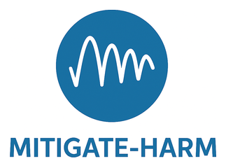

# mmc-sysid-benchmark

[](https://doi.org/10.5281/zenodo.24417707)
[](LICENSE)
[](https://creativecommons.org/licenses/by/4.0/)

**A Survey and Simulation-Based Benchmark of System Identification for Converter-Dominated Power Systems**

Code and data for a controlled benchmark of system-identification (SI) methods on a high-fidelity grid-connected modular multilevel converter (MMC) model, simulated in RTDS/RSCAD. The benchmark accompanies a structured review of SI methods in three families:

1. **Classical SI**: subspace (N4SID-CVA, FDSID), prediction-error (PEM), polynomial (ARX, OE, BJ), transfer-function (TFEST), process and impulse-response models
2. **Nonlinear and ML-based SI**: NLARX and Hammerstein–Wiener (NLHW) models with wavelet, sigmoid, tree-partition, neural-network, SVM, regression-tree and Gaussian-process nonlinearities
3. **Hybrid and physics-informed SI**: a physics-based baseline combined with a learned neural correction

All methods use the same dataset, input–output definitions, preprocessing, validation split and error metrics (MSE, RMSE, NMSE, FPE, fit %), and the benchmark also reports execution times.

> **Scope.** The numerical results hold only for the implementations and operating conditions evaluated here. They are not a universal ranking of SI methods.

---

## Test system

- **Model:** onshore MMC station of the CIGRE B4.57 point-to-point MMC-HVDC benchmark. It is connected to a balanced AC grid through a low-frequency transformer and to an ideal DC bus.
- **Control:** an outer P/Q loop and an inner loop for output and circulating current
- **Key parameters:** 200 submodules per arm, $L_\text{arm}$ = 0.029 p.u., $C_\text{SM}$ = 10 mF, 60 Hz, 220 kV secondary, 266.667 MVA per phase
- **MIMO structure:** 2 × 2 *dq*-frame admittance. The inputs are the *dq* voltage perturbations ($v_d$, $v_q$) and the outputs are the *dq* current responses ($i^\Delta_d$, $i^\Delta_q$) at the PCC.

## Data

The full dataset is included in [`data/`](data/), about 49 MB of RSCAD exports. See [`data/README.md`](data/README.md) for file formats, signal names and the test-case naming scheme.

| Folder | Content |
|---|---|
| `data/time_domain/benchmark_IGDQ/` | time-domain benchmark record: $v_d, v_q \rightarrow i_d, i_q$; 20,000 samples, Ts = 50 µs; first 50 % for estimation, last 50 % for validation |
| `data/time_domain/Test1–5_CT_*` | time-domain records under different noise levels, power setpoints and L–R parameters |
| `data/frequency_domain/Test6–11_FT_*` | 2 × 2 *dq* admittance sweeps (up to 70 frequencies, 1–1000 Hz) under different noise levels, power setpoints and L–R parameters |

[`data/manifest.csv`](data/manifest.csv) indexes every file, and [`data/SHA256SUMS`](data/SHA256SUMS) lets you check integrity.

## Repository structure

<!-- TODO: add code folders once uploaded -->
```
mmc-sysid-benchmark/
├── data/                  # RTDS/RSCAD dataset (time- and frequency-domain)
├── assets/logos/          # funder logos
├── classical/             # frequency- and time-domain linear SI (Sec. 2)
├── nonlinear_ml/          # NLARX, NLHW and ML estimators (Sec. 3)
├── hybrid/                # physics-informed / hybrid identification (Sec. 4)
├── utils/                 # metrics (MSE, RMSE, NMSE, FPE, fit), plotting
├── results/               # generated figures and tables
├── CITATION.cff
├── LICENSE
└── README.md
```

## Requirements

<!-- TODO: confirm versions -->
- MATLAB R20xx or later with the **System Identification Toolbox** (classical and nonlinear methods)
- *(if applicable)* Python ≥ 3.10 with the packages in `requirements.txt` (hybrid / neural models)
- RTDS/RSCAD is needed **only** to regenerate the data. The supplied dataset is enough to reproduce all results.

## Reproducing the results

<!-- TODO: replace with actual entry-point scripts -->
| Paper item | Script |
|---|---|
| Figs. 3–6, Table 2 (frequency domain) | `classical/run_frequency_domain.m` |
| Figs. 7–8, Monte Carlo study (noise / parameters) | `classical/run_noise_montecarlo.m` |
| Figs. 13–16, 19, Table 4 (time domain) | `classical/run_time_domain.m` |
| Figs. 17–18, 20–21, Tables 6–7 (NLARX / NLHW) | `nonlinear_ml/run_nonlinear.m` |
| Figs. 22–23 (hybrid) | `hybrid/run_hybrid` |

## Citation

If you use this code or dataset, please cite the paper. GitHub's **"Cite this repository"** button produces the entry from [`CITATION.cff`](CITATION.cff).

```bibtex
@unpublished{singh2026sysid,
  author = {Singh, Sunny and Mishra, Saurabh and Reyes Dreke, Victor Daniel and Rane, Rahul and Leki{\'c}, Aleksandra},
  title  = {A Survey and Simulation-Based Benchmark of System Identification for Converter-Dominated Power Systems},
  note   = {Preprint submitted to Elsevier},
  year   = {2026}
}
```

When you reuse the data or code, please also cite them directly:

```bibtex
@software{singh2026mmcsysid,
  author    = {Singh, Sunny and Mishra, Saurabh and Reyes Dreke, Victor Daniel and Rane, Rahul and Leki{\'c}, Aleksandra},
  title     = {mmc-sysid-benchmark: System identification benchmark for a grid-connected {MMC} ({RTDS/RSCAD})},
  version   = {v1.0},
  publisher = {Zenodo},
  year      = {2026},
  doi       = {10.5281/zenodo.24417707},
  url       = {https://doi.org/10.5281/zenodo.24417707}
}
```

## Authors

- **Sunny Singh**: TU Delft (corresponding author, s.singh-6@tudelft.nl)
- **Saurabh Mishra**: Indian Institute of Technology (BHU), Varanasi
- **Victor Daniel Reyes Dreke**: TU Delft
- **Rahul Rane**: TU Delft
- **Aleksandra Lekić**: TU Delft

Faculty of Electrical Engineering, Mathematics and Computer Science, Delft University of Technology, The Netherlands.

## Acknowledgement

<p align="center">
  
  &nbsp;&nbsp;
  
  &nbsp;&nbsp;
  
  &nbsp;&nbsp;
  
</p>

We gratefully acknowledge the support of the **MITIGATE-HARM** project (*MITIGATE HARMonics in power electronics-based power systems*), coordinated by TU Delft. We thank all project partners for their collaboration and valuable input.

MITIGATE-HARM is funded by CETPartnership, the Clean Energy Transition Partnership, under the 2024 joint call for research proposals, co-funded by the European Commission (GA N°101069750) and with the funding organisations detailed on <https://cetpartnership.eu/funding-agencies-and-call-modules>. The Dutch part of the project is funded by the Dutch Research Council (NWO).

## License

- **Code:** [MIT](LICENSE)
- **Data** (`data/`): [CC BY 4.0](https://creativecommons.org/licenses/by/4.0/)
- **Logos** (`assets/logos/`) remain the property of their respective owners and are not covered by either license.
